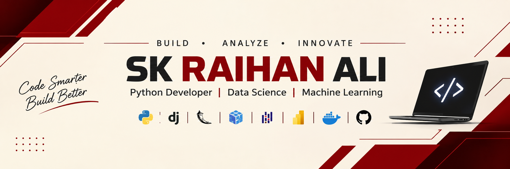

<!-- Save your banner image as assets/banner.jpeg and upload it to this repository -->

 

  

&nbsp;

&nbsp;

---

### 👨‍💻 About Me

Hi, I'm **SK Raihan Ali** — a passionate **Computer Science & Engineering (Data Science)** student at **Brainware University**.

I love turning ideas into real applications using **Python**, **Machine Learning**, and modern web technologies. My focus is on building practical, useful projects that solve real problems.

- 🎓 Currently pursuing **B.Tech in CSE (Data Science)** (2023 – 2027)
- 💻 Strong interest in **Software Development + AI/ML**
- 🐍 Comfortable with **Python, Django, Flask**
- 📊 Enjoy working on **Data Analysis, EDA & Predictive Modelling**
- 🧠 Exploring **Machine Learning, Deep Learning & NLP**
- 🚀 Open to **Internships** and **full-time opportunities**

---

### 🔥 Currently Focusing On

- Building end-to-end Machine Learning applications
- Strengthening Data Science fundamentals (Statistics + EDA)
- Improving backend development with Django & Flask
- Exploring deployment & real-world project architecture

---

### 🛠️ Tech Stack & Tools

#### Programming Languages

  

#### Web Development

  

#### Data Science & Analytics

  
  
  
  
  
  

#### Machine Learning & AI

  
  
  
  

**Algorithms:** Linear Regression • Logistic Regression • Decision Trees • Random Forest • Gradient Boosting  

**Core Concepts:** Statistics • Exploratory Data Analysis (EDA) • Data Preprocessing • Feature Engineering

#### Databases

  
  
  

#### Tools & Platforms

  
  
  
  
  

---

### 🚀 Featured Projects

#### 01. Community Waste Management System
A full-stack web application that helps improve waste management through public reporting, municipality management, and worker assignment.

**Key Features**
- Role-based authentication & dashboards
- Waste reporting with location management
- Municipality-specific report handling
- Worker assignment & status tracking
- Real-time notifications & updates

**Tech Stack:** `Python` · `Django` · `SQLite` · `Bootstrap` · `HTML/CSS`

  
  &nbsp;
  

---

#### 02. Employee Attrition Prediction
Machine Learning project using IBM HR Analytics data to analyze employee characteristics and predict attrition.

**Key Features**
- Complete Exploratory Data Analysis
- Data preprocessing & feature engineering
- Classification model development
- Attrition prediction system

**Tech Stack:** `Python` · `Pandas` · `NumPy` · `Scikit-learn` · `Machine Learning`

  
  &nbsp;
  

---

#### 03. Student Mark Prediction
Machine Learning application that predicts student performance based on various input features.

**Key Features**
- Data preprocessing pipeline
- Model training & prediction
- Flask-based web interface
- Clean ML integration

**Tech Stack:** `Python` · `Flask` · `Scikit-learn` · `Machine Learning`

  

---

#### 04. Iris Flower Prediction
Interactive Machine Learning app that predicts iris flower species based on flower measurements.

**Key Features**
- Classification using Machine Learning
- Interactive prediction interface
- Clean model integration
- Deployed with Streamlit

**Tech Stack:** `Python` · `Scikit-learn` · `Streamlit`

  
  &nbsp;
  

---

### 🎓 Education

**Bachelor of Technology (B.Tech)**  
**Computer Science & Engineering – Data Science**  
**Brainware University**  
2023 – 2027 | Currently Pursuing

---

### 📜 Courses & Professional Development

- Data Science, AI & Machine Learning using Python – Academy of Skill Development (ASD)
- Data Science / Machine Learning – Udemy
- Python Django & AI Integration

---

### 🏆 Activities & Achievements

- Smart India Hackathon 2025
- Samsung Innovation Coding Camp

---

### 📊 GitHub Statistics

  

---

### 📈 Contribution Activity

  

---

### 🤝 Let's Connect

I'm always open to learning, collaborating on interesting projects, and connecting with people in the **software development** and **data science** communities.

  
  &nbsp;
  
  &nbsp;
  

---

### Thanks for visiting my profile!

**Keep Learning. Keep Building. Keep Innovating.** 🚀

